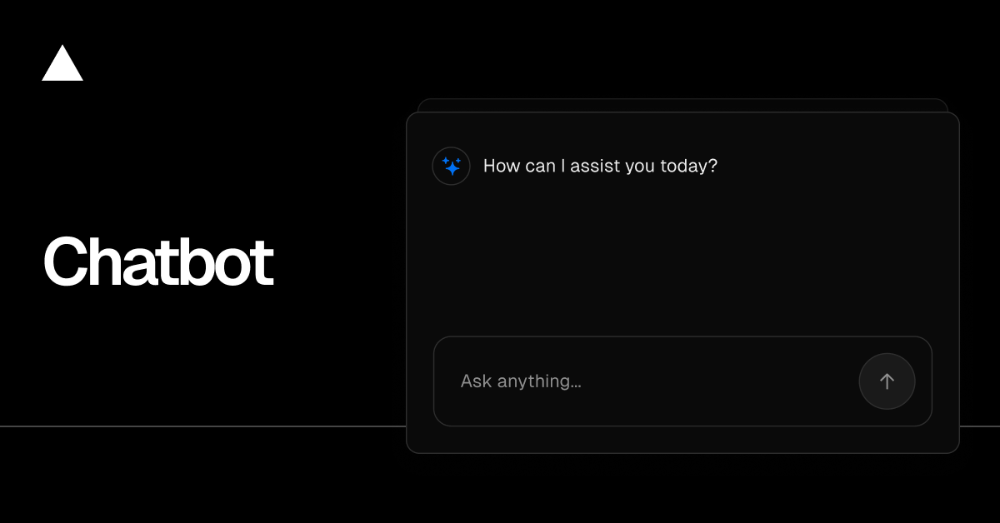

<a href="https://chatbot.ai-sdk.dev/demo">
  
  <h1 align="center">Chatbot</h1>
</a>

<p align="center">
    Chatbot (formerly AI Chatbot) is a free, open-source template built with Next.js and the AI SDK that helps you quickly build powerful chatbot applications.
</p>

<p align="center">
  <a href="https://chatbot.ai-sdk.dev/docs"><strong>Read Docs</strong></a> ·
  <a href="#features"><strong>Features</strong></a> ·
  <a href="#model-providers"><strong>Model Providers</strong></a> ·
  <a href="#deploy-your-own"><strong>Deploy Your Own</strong></a> ·
  <a href="#running-locally"><strong>Running locally</strong></a>
</p>
<br/>

## Features

- [Next.js](https://nextjs.org) App Router
  - Advanced routing for seamless navigation and performance
  - React Server Components (RSCs) and Server Actions for server-side rendering and increased performance
- [AI SDK](https://ai-sdk.dev/docs/introduction)
  - Unified API for generating text, structured objects, and tool calls with LLMs
  - Hooks for building dynamic chat and generative user interfaces
  - Supports OpenAI, Anthropic, Google, xAI, and other model providers via AI Gateway
- [shadcn/ui](https://ui.shadcn.com)
  - Styling with [Tailwind CSS](https://tailwindcss.com)
  - Component primitives from [Radix UI](https://radix-ui.com) for accessibility and flexibility
- Data Persistence
  - [Neon Serverless Postgres](https://vercel.com/marketplace/neon) for saving chat history and user data
  - [Vercel Blob](https://vercel.com/storage/blob) for efficient file storage
- [Auth.js](https://authjs.dev)
  - Simple and secure authentication

## Model Providers

This template uses the [Vercel AI Gateway](https://vercel.com/docs/ai-gateway) to access multiple AI models through a unified interface. Models are configured in `lib/ai/models.ts` with per-model provider routing. Included models: Mistral, Moonshot, DeepSeek, OpenAI, and xAI.

### AI Gateway Authentication

**For Vercel deployments**: Authentication is handled automatically via OIDC tokens.

**For non-Vercel deployments**: You need to provide an AI Gateway API key by setting the `AI_GATEWAY_API_KEY` environment variable in your `.env.local` file.

With the [AI SDK](https://ai-sdk.dev/docs/introduction), you can also switch to direct LLM providers like [OpenAI](https://openai.com), [Anthropic](https://anthropic.com), [Cohere](https://cohere.com/), and [many more](https://ai-sdk.dev/providers/ai-sdk-providers) with just a few lines of code.

## Deploy Your Own

You can deploy your own version of Chatbot to Vercel with one click:

[](https://vercel.com/templates/next.js/chatbot)

## Running locally

Create a `.env.local` file from [`.env.example`](.env.example) and set at least `AUTH_SECRET`, `POSTGRES_URL`, and `AI_GATEWAY_API_KEY`. PostgreSQL must be reachable when you run database migrations or use features that persist chat and user data. Redis and Vercel Blob credentials are only needed if you enable those integrations. You can use [Vercel Environment Variables](https://vercel.com/docs/projects/environment-variables) instead of a local `.env.local` file.

> Note: You should not commit your `.env` file or it will expose secrets that will allow others to control access to your various AI and authentication provider accounts.

If you use Vercel for environment-variable management, install the Vercel CLI, link the project with `vercel link`, and download the variables with `vercel env pull`.

```bash
pnpm install
pnpm db:migrate # Apply database schema changes (requires a reachable PostgreSQL database)
pnpm dev
```

Your app template should now be running on [localhost:3000](http://localhost:3000).
